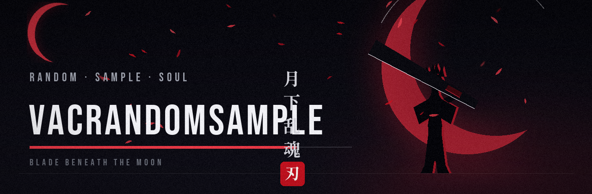

  

**「 月下乱魂 」** · random · sample · soul

**🇷🇺 Русский** · [🇬🇧 English](README.en.md)

## 🌙 「Обо мне」

| | |
|:---:|---|
| 🔱 **Звание** | Синигами-разработчик — режу шум, оставляю сигнал |
| 🌸 **Отряд** | Готэй 13 · fullstack |
| ⚔️ **Дзампакто** | Python · TypeScript · React |
| 🌙 **Режим** | Пишу код ночами — когда встаёт багровая луна |
| 🚪 **Врата** | Открыт к коллаборациям и интересным задачам |

  

## ⚔️ 「Арсенал」

  

## 📊 「Статистика души」

  
  

  

  

  

### 🐍 「Змейка вкладов」

<picture>
  <source media="(prefers-color-scheme: dark)" srcset="assets/github-snake/github-contribution-grid-snake-dark.svg">
  <source media="(prefers-color-scheme: light)" srcset="assets/github-snake/github-contribution-grid-snake.svg">
  
</picture>

## 📫 「Вызов」

*Достаточно назвать своё имя — и Врата откроются.*

**「 月が綺麗ですね 」** — спасибо, что заглянул под луну ✦

